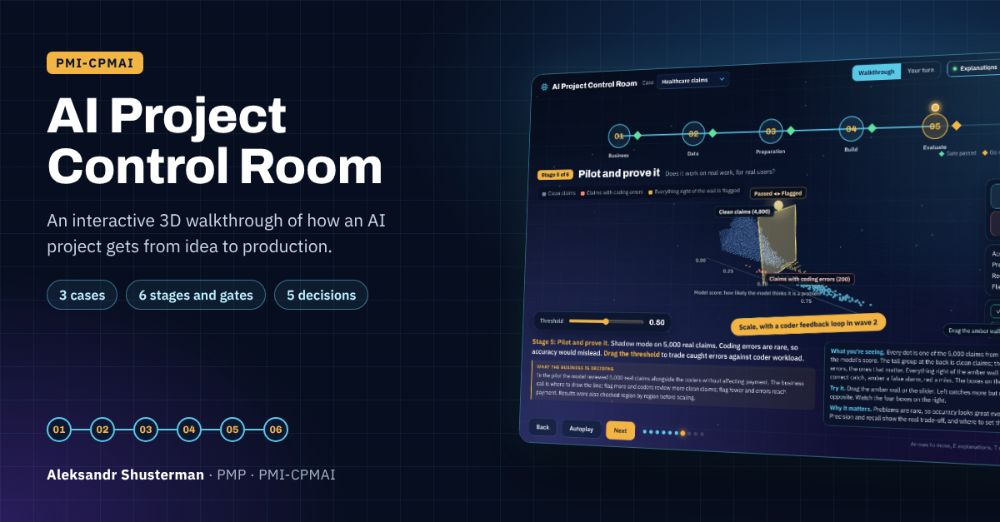

# AI Project Control Room

**An interactive 3D walkthrough of how an AI project gets from idea to production, using the PMI-CPMAI method.**

### [▶ Open the live demo](https://ashusterman1988.github.io/ai-project-control-room/)

## What it is

Most AI projects that stall do so for business and data reasons, not because the model was wrong. This demo follows one project through the six stages of the PMI-CPMAI method and shows how a go or no-go gate at each stage catches those problems early.

You pick one of three fictional projects and walk it from the business problem to launch and beyond:

| Case | Industry | AI pattern |
|---|---|---|
| Freight invoices | Logistics | Patterns and anomalies |
| Service parts returns | Service supply chain | Recognition + Predictive analytics |
| Healthcare claims | Healthcare | Patterns and anomalies + Predictive analytics |

## The six stages

| # | CPMAI phase | The question it answers |
|---|---|---|
| 1 | Business Understanding | Is this a problem worth solving, and is AI the right tool? |
| 2 | Data Understanding | Do we have the data to support the goal? |
| 3 | Data Preparation | Is the data fit for a model to learn from? |
| 4 | Model Development | How do we get the capability, and does it beat today? |
| 5 | Model Evaluation | Does it work on real work, for real users? |
| 6 | Model Operationalization | Will it keep delivering after launch? |

Each stage ends with a gate: go, go with conditions, or stop. Going back a stage is planned, not a failure.

## What you can do

- **Walkthrough:** ten slides with a 3D scene, the business problem, and a plain explanation of what each visual shows.
- **Your turn:** five real project decisions. Wrong calls add time and money to a running counter, with the math shown at the end.
- **Wrap-up:** the gate criteria for every CPMAI phase, the seven patterns of AI, and how the chosen case passed each gate.
- **2-minute tour:** a hands-off autoplay of the whole walkthrough, started from the intro page.

## How to use it

Open the [live demo](https://ashusterman1988.github.io/ai-project-control-room/) in Chrome, Edge, or Safari on a laptop. Press **Full screen** for the best view.

- Right arrow or **Next** moves forward, left arrow goes back
- Drag to rotate the 3D scenes, scroll to zoom
- **E** hides the explanations, **T** switches mode, **F** goes full screen

## Built with

A single HTML file with no install and no build step. 3D rendering uses [Three.js](https://threejs.org/), loaded from a CDN with an embedded copy so it also works offline.

## About

Built by **Aleksandr Shusterman**, PMP, PMI-CPMAI, to show how I run AI implementations. The cases, companies, and numbers are fictional; the method, decisions, and trade-offs are real.

Open to AI implementation and deployment roles. [Connect on LinkedIn](https://www.linkedin.com/in/aleksandrshusterman) or email [ashusterman1988@gmail.com](mailto:ashusterman1988@gmail.com).

PMI, PMP, and PMI-CPMAI are marks of the Project Management Institute. This is an independent demo, not affiliated with or endorsed by PMI.
